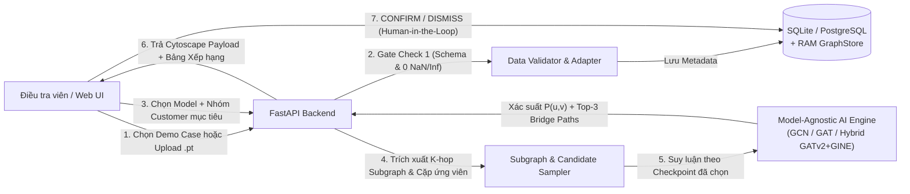
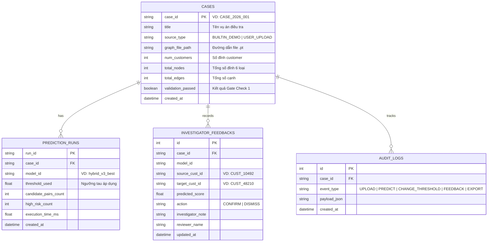

# TÀI LIỆU ĐẶC TẢ YÊU CẦU HỆ THỐNG & HƯỚNG DẪN TRIỂN KHAI (SRS & MASTER INSTRUCTION)
**Tên hệ thống:** Hệ thống Hỗ trợ Ra quyết định Phát hiện Liên kết Ẩn và Khôi phục Quan hệ Đồng phạm Ứng dụng GNN (AML-DSS)  
**Tên GitHub Repository chuẩn:** `ausaml-collusion-dss` *(Gợi ý thay thế: `aml-link-sentinel` hoặc `hetero-gnn-aml-dss`)*  
**GitHub Description (Tagline):** *"GNN-Powered Decision Support System for Covert AML Accomplice & Collusion Link Prediction on AusAML Heterogeneous Graphs"*  
**Phiên bản:** 2.0 (Bản Đặc tả Kỹ thuật Đầy đủ & Phân chia Công việc — Nâng cấp từ SRS v1.1)  
**Mục tiêu:** Thiết kế kiến trúc Web/App phục vụ suy luận quy nạp (Inductive Inference) trên các tập dữ liệu/vụ án mới dựa trên các mô hình GNN đã huấn luyện của nhóm (`CK GCN`, `CK GAT`, `Hybrid GATv2+GINE`, `HeteroSAGE`, `HeteroGAT-Only`), hỗ trợ điều tra viên phân tích, đối chứng đa mô hình, giải thích đường đi bắc cầu và xác minh mạng lưới đồng phạm.

---

## 1. TỔNG QUAN HỆ THỐNG, TÍNH KHẢ THI & CHIẾN LƯỢC TRIỂN KHAI

### 1.1. Phạm vi và Mục tiêu Nghiệp vụ
Hệ thống đóng vai trò là công cụ **Hỗ trợ Ra quyết định (Decision Support System — DSS)** dành cho chuyên viên điều tra chống rửa tiền (AML Investigator), nhận đầu vào là dữ liệu đồ thị giao dịch và định danh của một vụ án hoặc tập khách hàng mới, thực hiện kiểm tra hợp lệ (`Gate Check 1`), khoanh vùng lân cận và gọi mô hình GNN đã huấn luyện để:
1. Dự đoán xác suất tồn tại quan hệ đồng phạm ẩn $P(u, v) \in [0, 1]$ giữa các cặp thực thể khách hàng (`customer`) chưa từng khai báo quan hệ công khai (`RELATED_TO`).
2. Xếp hạng các cặp nghi vấn hàng đầu (`Top-K` / `Hits@K`) và phân tầng rủi ro tự động theo ngưỡng tối ưu $\tau_{\text{val}}$ (`val_f1_threshold`) của từng checkpoint.
3. Giải thích lý do gợi ý thông qua **Top-3 đường đi bắc cầu (Bridge Meta-paths / Covert Channels)**, biểu đồ đặc trưng cấu trúc cặp (`Pairwise Structural Profile`) và trọng số Attention $\alpha_{ij}$.
4. Cho phép **đối chứng đa mô hình (Multi-Model Side-by-Side Comparison)** между nhánh Đồng thể (`CK GCN`, `CK GAT`) và nhánh Dị thể (`Hybrid GATv2+GINE`) ngay trên cùng một vụ án, đồng thời lưu vết quyết định của điều tra viên (**Human-in-the-Loop**: `CONFIRM` / `DISMISS`).

### 1.2. Kiến trúc Tổng thể 4 Tầng (Lộ trình 2 Giai đoạn Khả thi)
Hệ thống thiết kế theo kiến trúc **4 tầng tách biệt**, cho phép triển khai gọn nhẹ, chạy mượt ngay trên máy cá nhân khi bảo vệ đồ án (Giai đoạn 1) và sẵn sàng mở rộng lên quy mô doanh nghiệp (Giai đoạn 2):

1. **Presentation Layer (Frontend):**
   * **Tech Stack:** `Next.js 14 (App Router)` hoặc `React + Vite` + `TypeScript` + `TailwindCSS` + `shadcn/ui`.
   * **Trực quan hóa đồ thị & Biểu đồ:** `Cytoscape.js` (`react-cytoscapejs` — tối ưu cho đồ thị dị thể đa hình dạng đỉnh, cạnh nét liền/nét đứt, highlight đường đi bắc cầu) + `Recharts` (Radar chart đặc trưng cặp & Bar chart đối chiếu Benchmark).
2. **Application & API Layer (Backend):**
   * **Tech Stack:** `Python 3.10+` + `FastAPI` + `Uvicorn` + `Pydantic v2` + `SQLAlchemy / SQLModel`.
   * **Chức năng:** Quản lý hồ sơ vụ án (`Case Management`), kiểm định schema dữ liệu (`DataValidator`), trích xuất K-hop subgraph, điều phối suy luận và ghi nhật ký kiểm toán (`Audit Log`).
3. **AI Inference & Explainability Engine (Pluggable / Model-Agnostic):**
   * **Tech Stack:** `PyTorch` + `PyTorch Geometric (torch_geometric)` + `SciPy (sparse CSR)` + `NetworkX`.
   * **Chức năng:** Giao diện trừu tượng `BaseLinkPredictor` đóng gói thống nhất cả mô hình Đồng thể (`GCN`, `GAT`, `Ensemble GCN+GAT` từ `CK/src/models.py`) và mô hình Dị thể (`HybridGATGIN v3/v4`, `HeteroSAGE`, `HeteroGAT-Only`), kèm bộ trích xuất đường đi bắc cầu `BridgePathExtractor`.
4. **Data Storage Layer:**
   * **Giai đoạn 1 (MVP / Demo đồ án — Khả thi ngay):**
     * **In-Memory Graph Store & Case Bundles (`.pt`):** Giữ đồ thị nền và **5 Hồ sơ Vụ án mẫu (Built-in Demo Cases)** trên RAM giúp truy xuất K-hop subgraph dưới `100ms`, không bắt người dùng chờ upload file `214 MB` mỗi lần mở web.
     * **Relational DB (`SQLite` mặc định `aml_dss.db`, tương thích 100% `PostgreSQL` qua `DATABASE_URL`):** Lưu thông tin vụ án, lịch sử chạy dự đoán, danh sách liên kết đã xác nhận (`confirmed_links`) và nhật ký phản hồi (`Human-in-the-Loop logs`).
   * **Giai đoạn 2 (Mở rộng Production):** Bổ sung **Neo4j (Graph Database)** khi quy mô đồ thị vượt giới hạn RAM (hàng chục triệu đỉnh/cạnh).

### 1.3. Sơ đồ Luồng Hoạt động Cốt lõi



---

## 2. CẤU TRÚC THƯ MỤC MONOREPO CHUẨN (`ausaml-collusion-dss/`)

```text
ausaml-collusion-dss/
├── README.md                                 # Hướng dẫn cài đặt 1 lệnh, kiến trúc & ảnh chụp màn hình
├── docker-compose.yml                        # Chạy đồng bộ Backend (8000) + Frontend (3000)
├── .env.example                              # Cấu hình PORT, DATABASE_URL, DEFAULT_MODEL_ID
│
├── models/                                   # Kho chứa Checkpoints & Tham số Chuẩn hóa đóng băng
│   ├── model_registry.json                   # Danh mục toàn bộ model, ngưỡng tau_val & metrics chuẩn
│   ├── frozen_scalers.pt                     # Tham số mean/std đóng băng từ tập Train (chống rò rỉ)
│   ├── gcn_seed42.pt                         # Checkpoint CK GCN thuần (Homo 60d)
│   ├── gat_seed42.pt                         # Checkpoint CK GAT thuần (Homo 60d, 4 heads)
│   ├── best_hybrid_gat_gin_v3_seed42.pt      # Checkpoint Hybrid GATv2+GINE v3 (F1=0.7403, Type4=0.9559)
│   └── best_hybrid_gat_gin_v4_seed42.pt      # Checkpoint Hybrid v4 (Hits@10=0.6965, Full-Graph 24d)
│
├── data/
│   ├── processed/                            # Chứa processed_graph.pt, train/val/test_pairs.pt
│   └── demo_cases/                           # 5 Hồ sơ Vụ án mẫu (.pt nhẹ ~1-3MB/case) nạp tức thì
│       ├── case_01_smurfing_ring.pt          # Vụ án chia nhỏ giao dịch (Structuring / Smurfing)
│       ├── case_02_shared_device_mule.pt     # Đường dây dùng chung Thiết bị & IP ngầm
│       ├── case_03_hard_neg_type1_trap.pt    # Bẫy Type 1: 2 tội phạm AML thuộc 2 vụ án rời nhau
│       ├── case_04_hard_neg_type4_trap.pt    # Bẫy Type 4: 2 người sạch dùng chung IP/Device công cộng
│       └── case_05_test_benchmark_3420.pt    # Tập Test chuẩn (3,420 cặp) phục vụ Regression Test
│
├── backend/
│   ├── requirements.txt
│   ├── app/
│   │   ├── main.py                           # Điểm vào FastAPI, CORS, Startup nạp sẵn Model & Demo Cases
│   │   ├── config.py                         # Cấu hình đường dẫn & biến môi trường
│   │   ├── database.py                       # Kết nối SQLite / PostgreSQL (SQLAlchemy)
│   │   ├── models_db.py                      # ORM Tables: CaseRecord, PredictionRun, FeedbackLog, AuditLog
│   │   ├── schemas.py                        # Pydantic Request/Response Schemas cho 7 API Endpoints
│   │   │
│   │   ├── engine/                           # Tầng AI Inference & Data Adapter (Model-Agnostic)
│   │   │   ├── base.py                       # Lớp trừu tượng BaseLinkPredictor
│   │   │   ├── registry.py                   # Quản lý nạp/chuyển đổi nóng giữa GCN, GAT, Hybrid
│   │   │   ├── validator.py                  # Kiểm định Gate Check 1 (6 loại đỉnh, 14 cạnh, 0 NaN/Inf)
│   │   │   ├── homo_adapter.py               # Adapter đồ thị đồng nhất 60d (kế thừa CK/src/data_validator.py)
│   │   │   ├── hetero_adapter.py             # Adapter đồ thị dị thể + Meta-paths + Pairwise Features
│   │   │   ├── predictor_homo.py             # Wrapper cho GCNEncoder, GATEncoder & Ensemble (CK/src/models.py)
│   │   │   ├── predictor_hetero.py           # Wrapper cho HybridGATGIN, HeteroSAGE, HeteroGATOnly
│   │   │   ├── subgraph_sampler.py           # Khoanh vùng K-hop lân cận & lọc cặp ứng viên <= 4 hops
│   │   │   └── explainer.py                  # Tìm Top-3 Bridge Meta-paths, Attention & sinh giải thích TV
│   │   │
│   │   └── routers/                          # Các nhóm REST API Endpoints
│   │       ├── cases.py                      # GET/POST /api/v1/cases, /api/v1/cases/upload
│   │       ├── predict.py                    # POST /api/v1/cases/{id}/predict, /explain-pair
│   │       ├── feedback.py                   # POST /api/v1/cases/{id}/feedback, GET /export
│   │       └── benchmarks.py                 # GET /api/v1/models, /api/v1/benchmarks/summary
│   │
│   └── tests/                                # Kiểm thử tự động
│       ├── test_regression_full_graph.py     # Kiểm thử khớp 100% ROC-AUC & AP (< 1e-5)
│       ├── test_subgraph_latency.py          # Kiểm thử thời gian phản hồi <= 3.0s
│       └── test_feedback_audit.py            # Kiểm thử lưu vết CONFIRM / DISMISS
│
└── frontend/
    ├── package.json
    └── src/
        ├── app/                              # Các trang chính (Next.js App Router)
        │   ├── page.tsx                      # Trang chủ: Tổng quan hệ thống & Chọn nhanh Vụ án
        │   ├── workspace/page.tsx            # Màn hình chính: DSS Interactive Graph Workspace
        │   ├── benchmark/page.tsx            # Màn hình: Đối chứng Đa mô hình (GCN vs GAT vs Hybrid)
        │   └── audit/page.tsx                # Màn hình: Nhật ký Điều tra (HITL) & Xuất Báo cáo
        ├── components/
        │   ├── graph/CytoscapeCanvas.tsx     # Bảng vẽ đồ thị đa thực thể + chú giải + zoom/filter
        │   ├── controls/InferenceSidebar.tsx # Chọn Model, Thanh trượt tau_val, Top-K, Bật/tắt 6 loại đỉnh
        │   ├── explain/EvidenceDrawer.tsx    # Hiển thị Top-3 Bridge Paths, Radar Chart & Nút Confirm/Dismiss
        │   └── tables/RankingTable.tsx       # Bảng xếp hạng cặp nghi vấn kèm huy hiệu High/Medium/Low Risk
        └── lib/api.ts                        # Client gọi FastAPI Backend
```

---

## 3. ĐẶC TẢ DỮ LIỆU ĐẦU VÀO & CƠ CHẾ ADAPTER (DATA SCHEMA & ADAPTERS)

Dữ liệu đồ thị gốc tuân theo cấu trúc **Heterogeneous Graph** gồm **6 loại đỉnh** và **7 loại cạnh gốc (14 quan hệ hai chiều xuôi/ngược)** từ pipeline tiền xử lý AusAML chuẩn của nhóm.

### 3.1. Đặc tả các Loại Đỉnh (Node Types & Features)

| Loại Đỉnh (`node_type`) | Số chiều gốc (`in_channels`) | Kiểu dữ liệu | Quy tắc Tiền xử lý & Ý nghĩa Nghiệp vụ |
| :--- | :---: | :---: | :--- |
| **`customer`** | `10` | `float32` | `c0`: `risk_score` (zscore); `c1..3`: `screening_flag` (one-hot 3); `c4`: `status_flag`; `c5`: `annual_income` (logz); `c6..8`: `is_individual, is_company, is_trust`; `c9`: `tenure_days` (zscore). |
| **`account`** | `6` | `float32` | `a0`: `account_age_days` (zscore); `a1`: cờ `is_missing` ($\in \{0, 1\}$ cho `last_activity_date`); `a2`: `last_activity` (logz); `a3..5`: cờ trạng thái nhị phân. |
| **`device`** | `6` | `float32` | Kết hợp One-hot loại thiết bị (`3d`) và các chỉ số tần suất/độ phân tán sử dụng nén `logz` (`3d`). |
| **`ip`** | `4` | `float32` | Các đặc trưng thống kê về địa chỉ IP và tần suất truy cập đã nén `logz`. |
| **`beneficiary`** | `8` | `float32` | Cờ `FATF high-risk` (`1d`), khu vực địa lý (`one-hot 3d`) và `4` chỉ số hành vi nhận tiền nén `logz`. |
| **`bank`** | `4` | `float32` | Ma trận đơn vị `eye(4)` đại diện cho 4 ngân hàng trong hệ sinh thái ($\{0.0, 1.0\}$). |

### 3.2. Đặc tả các Loại Cạnh Gốc (Edge Types & Attributes)

| Quan hệ (`src → rel → dst`) | Số chiều `edge_attr` | Kiểu dữ liệu | Ý nghĩa nghiệp vụ & Cạnh ngược tự động |
| :--- | :---: | :---: | :--- |
| `('customer', 'OWNS', 'account')` | `None` (0) | `int64` index | Quan hệ sở hữu tài khoản ngân hàng (+ `rev_OWNS`). |
| `('customer', 'BANKS_WITH', 'bank')` | `1` | `float32` | Khách hàng mở dịch vụ tại ngân hàng (+ `rev_BANKS_WITH`). |
| `('account', 'USES_DEVICE', 'device')` | `2` | `float32` | Lịch sử sử dụng thiết bị: `[logz(freq), norm_last_day]` (+ `rev_USES_DEVICE`). |
| `('account', 'USES_IP', 'ip')` | `2` | `float32` | Lịch sử truy cập địa chỉ IP: `[logz(freq), norm_last_day]` (+ `rev_USES_IP`). |
| `('account', 'TRANSACTS', 'account')` | `4` | `float32` | Giao dịch chuyển khoản nội bộ đã lọc self-loop, nén `logz` (+ `rev_TRANSACTS`). |
| `('account', 'WIRES_TO', 'beneficiary')` | `4` | `float32` | Giao dịch chuyển tiền ra bên thụ hưởng ngoài nén `logz` (+ `rev_WIRES_TO`). |
| `('customer', 'RELATED_TO', 'customer')` | `7` | `float32` | Quan hệ KYC công khai (`5 one-hot`: *director, shareholder, beneficiary, related party, trustee* + `% sở hữu` + `has_pct`). **100% đồng phạm AML ẩn không nằm trong cạnh này.** |

### 3.3. Cơ chế Adapter Tự động theo Kiến trúc Mô hình (`Model-Agnostic Adapter`)
Khi người dùng chọn một `model_id` trên giao diện, tầng `engine/` tự động điều phối dữ liệu qua đúng Adapter mà **không tính lại `mean/std` trên tập mẫu nhỏ** (sử dụng `frozen_scalers.pt` từ tập Train):
* **Nhánh 1 — Mô hình Đồng thể (`CK GCN`, `CK GAT`, `Ensemble GCN+GAT`):**
  * `HomoGraphAdapter` chiếu đồ thị dị thể về đồ thị khách hàng đồng nhất (`50,000` nút `customer`, vector đặc trưng **`60` chiều** = `44d` hành vi tổng hợp + `16d` Smooth Structural PE) nối qua 4 kênh (`RELATED_TO`, `SHARED_DEVICE`, `SHARED_IP`, `TRANSACTS_HIGH`).
* **Nhánh 2 — Mô hình Dị thể (`Hybrid GATv2+GINE`, `HeteroSAGE`, `HeteroGAT-Only`):**
  * `HeteroGraphAdapter` tăng cường trực tiếp trên `HeteroData`, cắt chiều nhiễu `rev_BANKS_WITH` từ 4 siêu nút `bank`, tạo 4 kênh Meta-path Shortcut có `edge_attr` (`SHARED_DEVICE`, `SHARED_IP`, `SHARED_BENEF`, `TRANSACTS_CUST`) và trích xuất vector **Pairwise Structural Features** (Common Neighbors theo kênh, Weighted Adamic-Adar, Jaccard, Multi-hop Random-Walk/PPR Cosine) đưa vào `StructureGatedLinkPredictor`.

---

## 4. THIẾT KẾ TẦNG AI INFERENCE & EXPLAINABILITY ENGINE

### 4.1. Giao diện Chuẩn `BaseLinkPredictor` (`backend/app/engine/base.py`)
Mọi mô hình trong hệ thống đều kế thừa lớp giao diện thống nhất sau để việc thêm/bớt model không ảnh hưởng tới API hay Frontend:

```python
from abc import ABC, abstractmethod
from typing import Dict, List, Any
import torch

class BaseLinkPredictor(ABC):
    model_id: str
    model_family: str          # "HOMO_GCN" | "HOMO_GAT" | "HETERO_HYBRID" | "ENSEMBLE"
    default_threshold: float   # Nạp từ model_registry.json (val_f1_threshold)

    @abstractmethod
    def load_checkpoint(self, checkpoint_path: str, device: str = "cpu") -> None:
        """Nạp trọng số đã huấn luyện lên CPU/GPU và chuyển sang chế độ eval()."""
        pass

    @abstractmethod
    @torch.no_grad()
    def predict_pairs(self, graph_bundle: Any, candidate_pairs: torch.Tensor) -> Dict[str, Any]:
        """
        Dự đoán xác suất đồng phạm cho danh sách cặp ứng viên [2, N_pairs].
        Trả về: {
            "probabilities": np.ndarray [N_pairs],
            "attention_map": Optional[Dict],   # Trọng số alpha_ij nếu là GAT / Hybrid
            "pairwise_signals": Optional[np.ndarray]
        }
        """
        pass
```

### 4.2. Danh mục Mô hình Khởi tạo Sẵn (`models/model_registry.json`)
Hệ thống đăng ký sẵn các mô hình thực nghiệm tốt nhất của nhóm (số liệu Mean ± Std trên 3 seeds `[42, 43, 44]`):

| `model_id` | Tên hiển thị trên UI | Kiến trúc | $\tau_{\text{val}}$ mặc định | Test ROC-AUC | Test AP | Test Hits@10 | Type 1 ROC-AUC | Type 4 ROC-AUC |
| :--- | :--- | :---: | :---: | :---: | :---: | :---: | :---: | :---: |
| `hybrid_v3_best` | **Hybrid GATv2+GINE (v3 — Khuyên dùng)** | Hetero Parallel Gated | `0.5000` | `0.8311` | `0.8447` | `0.6828` | `0.6773` | **`0.9559`** |
| `hybrid_v4_full` | **Hybrid Tri-Modal (v4 — 24d Full-Graph)** | Hetero Tri-Modal | `0.5682` | `0.8312` | `0.8454` | **`0.6965`** | `0.6853` | `0.9488` |
| `hetero_gat_v4` | **HeteroGAT-Only (2x Root-GATv2)** | Hetero GATv2 | `0.5100` | `0.8346` | `0.8485` | `0.7014` | `0.6957` | **`0.9627`** |
| `hetero_sage_v4` | **HeteroSAGE (2L + 24d Pairwise)** | Hetero GraphSAGE | `0.4900` | **`0.8358`** | **`0.8513`** | **`0.7059`** | **`0.7045`** | `0.9409` |
| `ck_gcn_seed42` | **CK Baseline — GCN Thuần (Homo + PE)** | Homo GCN | `0.3227` | `0.8113` | `0.7976` | `0.6704` | `0.6020` | `0.8306` |
| `ck_gat_seed42` | **CK Baseline — GAT Thuần (Homo + PE)** | Homo GAT (4 heads) | `0.4455` | `0.8000` | `0.7918` | `0.6477` | `0.5934` | `0.8125` |

---

## 5. YÊU CẦU CHỨC NĂNG (`FR-01` → `FR-06`) & PHI CHỨC NĂNG

### FR-01: Quản lý Vụ án & Nạp Dữ liệu Kép (Dual-Mode Data Ingestion)
* **FR-01.1 (Chế độ 1 — Built-in Demo Cases):** Hệ thống tích hợp sẵn 5 hồ sơ vụ án mẫu (`case_01` đến `case_05`) nạp sẵn trên RAM, cho phép điều tra viên chọn từ danh sách và chạy suy luận tức thì dưới `300ms`.
* **FR-01.2 (Chế độ 2 — Upload Vụ án Mới `.pt` / `.csv`):** Hỗ trợ tải lên file đồ thị đóng gói chuẩn PyTorch/PyG (`.pt`) hoặc gói CSV/JSON (kèm `frozen_scalers.pt`).
* **FR-01.3 (Gate Check 1 Validation):** Tự động kiểm định schema 6 loại đỉnh, 14 quan hệ, Bounds Check chỉ số cạnh, quét `0 NaN / 0 Inf`, và tự động sinh cạnh ngược (`rev_*`) nếu thiếu.

### FR-02: Trích xuất Đồ thị Con & Tạo Cặp Ứng viên (Subgraph & Candidate Sampling)
* **FR-02.1:** Cho phép điều tra viên tìm kiếm/chọn từ `2` đến `500` mã khách hàng (`CUST_xxxxx`) hoặc chọn toàn bộ một cụm nghi vấn trong vụ án.
* **FR-02.2:** Trích xuất vùng lân cận K-hop ($K \in \{2, 3\}$) quanh các `customer` mục tiêu (giới hạn hiển thị thông minh trên UI tối đa `300` đỉnh ưu tiên trọng số cao để không làm rối mắt điều tra viên, trong khi tầng AI vẫn chạy trên đủ toàn bộ subgraph).
* **FR-02.3:** Sinh danh sách cặp ứng viên `(Customer_A, Customer_B)` chưa có cạnh `RELATED_TO` và có khoảng cách đường đi trên đồ thị đầy đủ $\le 4$ bước nhảy (hoặc dùng danh sách cặp chỉ định sẵn khi chạy chế độ Benchmark).

### FR-03: Suy luận Dự đoán Liên kết & Phân tầng Rủi ro Động (Model-Agnostic Inference)
* **FR-03.1:** Cho phép chọn bất kỳ mô hình nào trong `model_registry.json` (hoặc chạy `Compare Models` giữa `CK GCN`, `CK GAT` và `Hybrid GATv2+GINE`).
* **FR-03.2 (Phân tầng rủi ro động theo $\tau_{\text{val}}$):** Tự động nạp ngưỡng $\tau_{\text{val}}$ của checkpoint đang chọn:
  * 🔴 **HIGH RISK ($P \ge \max(0.75, \tau_{\text{val}} + 0.20)$):** Nghi vấn đồng phạm đặc biệt nghiêm trọng, ưu tiên điều tra số 1.
  * 🟠 **MEDIUM RISK ($\tau_{\text{val}} \le P < \text{High}$):** Vượt ngưỡng F1 tối ưu của mô hình, cần đối chiếu đường đi bắc cầu.
  * 🟢 **LOW RISK / NOISE ($P < \tau_{\text{val}}$):** Dưới ngưỡng cảnh báo (bao gồm các bẫy `Type 1` khác kịch bản hoặc `Type 4` người sạch dùng chung IP công cộng đã được mô hình lọc).

### FR-04: Giải thích Mô hình & Truy vết Cầu nối (Explainability & Bridge Paths)
* **FR-04.1 (Top-3 Bridge Meta-paths):** Với mỗi cặp `(u, v)` được điều tra viên click chọn, hệ thống truy vết trên đồ thị dị thể và trả về tối đa **3 đường đi ngắn nhất & có trọng số bằng chứng cao nhất** nối giữa `u` và `v`:
  * *Kênh Thiết bị ngầm:* `CUST_u → OWNS → ACC_1 → USES_DEVICE → DEV_X ← USES_DEVICE ← ACC_2 ← OWNS ← CUST_v`
  * *Kênh Địa chỉ IP ngầm:* `CUST_u → OWNS → ACC_1 → USES_IP → IP_Y ← USES_IP ← ACC_2 ← OWNS ← CUST_v`
  * *Kênh Dòng tiền trực tiếp / qua trung gian (Mule):* `CUST_u → ACC_1 → TRANSACTS → ACC_2 → CUST_v` (hoặc qua `CUST_mule`).
  * *Kênh Người thụ hưởng chung:* `CUST_u → ACC_1 → WIRES_TO → BENEF_Z ← WIRES_TO ← ACC_2 ← CUST_v`.
* **FR-04.2 (Pairwise Structural Profile & Natural Language Explanation):**
  * Hiển thị biểu đồ thanh/radar 6 chỉ số cấu trúc của cặp `(u, v)`: *Shared Devices*, *Shared IPs*, *Direct/2-hop Transactions*, *Weighted Adamic-Adar*, *Multi-hop PPR Cosine*, và *Node Risk Similarity*.
  * Tự động sinh nhận định tiếng Việt rõ ràng cho điều tra viên *(Ví dụ: "Cảnh báo mức CAO (P = 91.4%): Hai khách hàng không khai báo quan hệ KYC nhưng dùng chung 2 thiết bị truy cập độc lập (DEV_0192, DEV_4410) và có chuỗi giao dịch bắc cầu 2-hop với độ tương đồng cấu trúc PPR = 0.34")*.

### FR-05: Tương tác Hỗ trợ Ra quyết định & Human-in-the-Loop (DSS Workspace)
* **FR-05.1 (Trực quan hóa đa thực thể):**
  * **6 hình dạng & màu sắc đỉnh:** `Customer` (Hình tròn lớn — Đỏ nếu High Risk, Xanh dương nếu bình thường), `Account` (Hình chữ nhật lục), `Device` (Hình thoi tím), `IP` (Hình lục giác cam), `Beneficiary` (Hình tam giác vàng), `Bank` (Hình ngôi sao/nhà băng xám).
  * **Quy ước cạnh:** Cạnh thực tế đã quan sát vẽ **nét liền**; cạnh đồng phạm do AI phát hiện vẽ **nét đứt màu đỏ/cam** kèm nhãn xác suất `%`.
* **FR-05.2 (Bộ lọc động):** Thanh trượt `Threshold` (có vạch dấu $\tau_{\text{val}}$), bộ lọc `Top-K`, công tắc ẩn/hiện từng loại thực thể để thu gọn đồ thị.
* **FR-05.3 (Human-in-the-Loop an toàn với GNN):**
  * Khi điều tra viên bấm **`CONFIRM` (Xác nhận đồng phạm)**: Lưu vào bảng `investigator_feedbacks`, đổi cạnh sang màu đỏ đậm có dấu tích `✓ Confirmed`, ghi Audit Log phục vụ xuất tập huấn luyện tăng cường định kỳ (**tuyệt đối không** chèn trực tiếp vào `edge_index` của `RELATED_TO` trong lúc đang suy luận để tránh làm sai lệch phân phối đồ thị khi chưa retrain).
  * Khi điều tra viên bấm **`DISMISS` (Bác bỏ / Báo động giả)**: Ẩn cạnh khỏi chế độ xem mặc định và lưu vào kho `Hard Negative Pool` để tinh chỉnh mô hình ở chu kỳ sau.
* **FR-05.4 (Xuất Hồ sơ Điều tra):** Xuất danh sách cặp đồng phạm, bằng chứng đường đi bắc cầu và lịch sử xác nhận ra file `CSV / JSON / Printable PDF Report`.

### FR-06: Phòng Thí nghiệm Đối chứng Đa mô hình (Model Benchmark & Ablation Arena)
* Cung cấp màn hình so sánh trực quan kết quả của `CK GCN`, `CK GAT`, `Hybrid GATv2+GINE (v3/v4)`, `HeteroSAGE`, `HeteroGAT-Only` trên toàn tập Test (`Overall` và `5 Scenarios: Type 1..5`), kèm tính năng **"Case Diff Finder"** — tự động liệt kê các cặp khó (`Type 1`, `Type 4`) mà `GCN/GAT` thuần dự đoán sai nhưng `Hybrid GATv2+GINE` dự đoán đúng để phục vụ thuyết trình đồ án.

---

## 6. THIẾT KẾ CƠ SỞ DỮ LIỆU NGHIỆP VỤ (`SQLite / PostgreSQL`)



---

## 7. ĐẶC TẢ GIAO DIỆN LẬP TRÌNH (REST API SPECIFICATION)

| STT | Method & Endpoint | Mô tả chức năng |
| :---: | :--- | :--- |
| 1 | `GET /api/v1/models` | Lấy danh sách toàn bộ mô hình trong `model_registry.json`, ngưỡng $\tau_{\text{val}}$ và bảng chỉ số Benchmark. |
| 2 | `GET /api/v1/cases` | Lấy danh sách các hồ sơ vụ án (gồm 5 Built-in Demo Cases và các vụ án do người dùng tải lên). |
| 3 | `POST /api/v1/cases/upload` | Tải lên file `.pt` vụ án mới, chạy `Gate Check 1` validation và đăng ký vào hệ thống. |
| 4 | `POST /api/v1/cases/{case_id}/predict` | Chạy suy luận GNN trên subgraph/full_graph, trả về bảng xếp hạng cặp đồng phạm và `graph_payload` cho `Cytoscape.js`. |
| 5 | `POST /api/v1/cases/{case_id}/explain-pair` | Truy vết chi tiết 1 cặp `(source, target)`: trả về Top-3 Bridge Paths, 6 chỉ số Pairwise Radar, câu giải thích tiếng Việt và điểm số đối chiếu của cả 3 mô hình (`GCN`, `GAT`, `Hybrid`). |
| 6 | `POST /api/v1/cases/{case_id}/feedback` | Ghi nhận quyết định `CONFIRM` hoặc `DISMISS` của điều tra viên vào Database & Audit Log. |
| 7 | `GET /api/v1/cases/{case_id}/export` | Xuất báo cáo kết quả điều tra và các liên kết đã xác nhận ra định dạng `CSV` hoặc `JSON`. |

### Mẫu Payload Chuẩn cho `POST /api/v1/cases/{case_id}/predict`
* **Request Body:**
```json
{
  "model_id": "hybrid_v3_best",
  "target_customer_ids": ["CUST_10492", "CUST_48210", "CUST_00912"],
  "inference_mode": "subgraph",
  "hop_depth": 2,
  "probability_threshold": null,
  "top_k": 20,
  "include_node_types": ["customer", "account", "device", "ip", "beneficiary"]
}
```
* **Response Body (`200 OK`):**
```json
{
  "case_id": "CASE_02_SHARED_DEVICE_MULE",
  "model_used": {
    "model_id": "hybrid_v3_best",
    "model_family": "HETERO_HYBRID",
    "default_threshold": 0.5000,
    "applied_threshold": 0.5000
  },
  "execution_time_ms": 185.4,
  "subgraph_stats": {
    "total_nodes": 312,
    "total_edges": 940,
    "candidate_pairs_evaluated": 420,
    "high_risk_pairs": 6,
    "medium_risk_pairs": 9
  },
  "predictions": [
    {
      "pair_id": "CUST_10492__CUST_48210",
      "source": "CUST_10492",
      "target": "CUST_48210",
      "score": 0.9421,
      "risk_level": "HIGH",
      "feedback_status": "PENDING",
      "model_comparison": {
        "ck_gcn_seed42": 0.7810,
        "ck_gat_seed42": 0.8125,
        "hybrid_v3_best": 0.9421
      },
      "pairwise_ summary": {
        "shared_devices": 2,
        "shared_ips": 1,
        "weighted_aa": 0.84,
        "ppr_multi_hop_cos": 0.31
      },
      "evidence_paths": [
        {
          "path_type": "SHARED_DEVICE",
          "nodes": ["CUST_10492", "ACC_0881", "DEV_0992", "ACC_0304", "CUST_48210"],
          "relations": ["OWNS", "USES_DEVICE", "rev_USES_DEVICE", "rev_OWNS"],
          "attention_score": 0.89,
          "description": "Hai khách hàng cùng đăng nhập qua thiết bị DEV_0992 (tín hiệu chú ý GATv2 = 0.89)."
        }
      ]
    }
  ],
  "graph_payload": {
    "nodes": [
      { "data": { "id": "CUST_10492", "label": "CUST_10492", "node_type": "customer", "risk_score": 0.91 } },
      { "data": { "id": "DEV_0992", "label": "DEV_0992", "node_type": "device" } }
    ],
    "edges": [
      { "data": { "id": "e1", "source": "CUST_10492", "target": "CUST_48210", "edge_category": "PREDICTED_LINK", "score": 0.9421, "risk_level": "HIGH" } }
    ]
  }
}
```

---

## 8. ĐẶC TẢ GIAO DIỆN NGƯỜI DÙNG (4 MÀN HÌNH CỐT LÕI)

1. **Màn hình 1 — Case Command Center (`/`)**:
   * Thẻ thống kê tổng quan hệ thống (50,000 Customers, 6 Node Types, 14 Relations, 6 Registered GNN Checkpoints).
   * Danh sách **5 Hồ sơ Vụ án mẫu** (bấm 1 click *"Mở Phòng Điều Tra"* là chuyển thẳng sang Workspace với dữ liệu đã nạp) + Khu vực kéo thả Upload file `.pt` vụ án mới kèm bảng kết quả kiểm định `Gate Check 1`.
2. **Màn hình 2 — DSS Interactive Graph Workspace (`/workspace`)**:
   * **Cột trái (25% — Bộ điều khiển DSS):** Chọn Vụ án, Chọn Mô hình (`Hybrid GATv2+GINE`, `CK GCN`, `CK GAT`...), Thanh trượt `Probability Threshold` (tự động nhảy về $\tau_{\text{val}}$ khi đổi model), Bộ lọc `Top-K`, Checkbox bật/tắt 6 loại đỉnh (`Customer`, `Account`, `Device`, `IP`, `Beneficiary`, `Bank`).
   * **Cột giữa (45% — Bảng vẽ Đồ thị `Cytoscape.js` & Bảng Xếp hạng):** Phía trên là đồ thị tương tác (hỗ trợ zoom, kéo thả, highlight đường đi bắc cầu khi click vào một cạnh nét đứt); phía dưới là bảng xếp hạng các cặp đồng phạm phát hiện được.
   * **Cột phải (30% — Bảng Giải thích Bằng chứng & Human-in-the-Loop):** Hiển thị chi tiết cặp `(u, v)` đang chọn: Điểm số so sánh giữa 3 mô hình (`GCN vs GAT vs Hybrid`), sơ đồ chuỗi **Top-3 Bridge Meta-paths**, biểu đồ Radar 6 đặc trưng cặp, lời giải thích tiếng Việt và 2 nút hành động **`[✓ Xác nhận Đồng phạm (Confirm)]`** / **`[✕ Bác bỏ (Dismiss)]`**.
3. **Màn hình 3 — Model Benchmark & Ablation Arena (`/benchmark`)**:
   * Bảng và biểu đồ cột nhóm đối chiếu kết quả `Mean ± Std (3 Seeds)` của `CK GCN`, `CK GAT`, `Hybrid v2/v3/v4`, `HeteroSAGE`, `HeteroGAT-Only` trên `Overall` và `Scenario 1..5`.
   * Tính năng **"Bẫy Kịch bản Khó (Hard Negative Showcase)"**: Cho phép lọc riêng các ca `Type 1 (AML–AML khác vụ án)` và `Type 4 (Shared IP/Device)` để chứng minh trực quan cách `Hybrid GATv2+GINE` giảm báo động giả so với `GCN/GAT` thuần.
4. **Màn hình 4 — Audit Log & Investigation Report (`/audit`)**:
   * Danh sách toàn bộ liên kết đã được điều tra viên `CONFIRM` hoặc `DISMISS`, bộ lọc theo vụ án/thời gian, và nút xuất báo cáo điều tra (`Export CSV / JSON / Printable Dossier`).

---

## 9. KHUNG PHÂN CHIA CÔNG VIỆC NHÓM (WBS — WORK BREAKDOWN STRUCTURE) & TIÊU CHÍ NGHIỆM THU

Để nhóm có thể chia việc song song mà không bị chồng chéo code, dự án được chia thành **4 Module độc lập** (phù hợp cho nhóm 3–4 thành viên hoặc chia làm 4 Sprint tuần tự):

| Module / Vai trò | Phạm vi & File phụ trách | Đầu việc cụ thể (Deliverables) | Đầu ra bàn giao (Interface Contract) |
| :--- | :--- | :--- | :--- |
| **Module 1: AI Engine & Demo Case Builder** | `models/*`<br>`data/demo_cases/*`<br>`backend/app/engine/*` | 1. Chuẩn hóa `model_registry.json` & gom checkpoints (`GCN`, `GAT`, `Hybrid v3/v4`).<br>2. Viết script trích xuất 5 file `case_01..05.pt` từ bộ dữ liệu AusAML.<br>3. Cài đặt `BaseLinkPredictor`, `HomoGraphAdapter`, `HeteroGraphAdapter` và `BridgePathExtractor`. | Cung cấp hàm Python `registry.predict(case_id, model_id, params)` và `explainer.explain_pair(case_id, u, v)` chạy độc lập, pass bài test khớp ROC-AUC `< 1e-5`. |
| **Module 2: FastAPI Backend & Database** | `backend/app/main.py`<br>`backend/app/database.py`<br>`backend/app/models_db.py`<br>`backend/app/routers/*` | 1. Thiết lập SQLite/PostgreSQL với 4 bảng (`cases`, `prediction_runs`, `investigator_feedbacks`, `audit_logs`).<br>2. Xây dựng 7 REST API Endpoints theo đúng JSON Schema ở Mục 7.<br>3. Tích hợp `DataValidator` (`Gate Check 1`) cho API upload `.pt` và API xuất báo cáo CSV/JSON. | Cung cấp Swagger UI (`http://localhost:8000/docs`) hoạt động đầy đủ 7 endpoints với dữ liệu thật từ Module 1. |
| **Module 3: Frontend Graph Workspace (Trọng tâm UI)** | `frontend/src/app/workspace/*`<br>`frontend/src/components/graph/*`<br>`frontend/src/components/explain/*` | 1. Tích hợp `Cytoscape.js` hiển thị 6 loại đỉnh, cạnh nét liền (quan sát) & nét đứt (dự đoán).<br>2. Xây dựng `InferenceSidebar` (đổi model tự nhảy $\tau_{\text{val}}$, lọc Top-K, ẩn/hiện lớp đỉnh).<br>3. Xây dựng `EvidenceDrawer` (hiển thị Top-3 Bridge Paths, Radar chart, so sánh 3 model & nút Confirm/Dismiss). | Giao diện điều tra đồ thị tương tác mượt mà, click vào cạnh nét đứt highlight ngay đường đi bắc cầu trên đồ thị. |
| **Module 4: Frontend Command Center, Benchmark & QA** | `frontend/src/app/page.tsx`<br>`frontend/src/app/benchmark/*`<br>`frontend/src/app/audit/*`<br>`backend/tests/*` | 1. Xây dựng trang chủ `Case Command Center` (chọn nhanh 5 Demo Cases + Upload `.pt` mới).<br>2. Xây dựng trang `Model Benchmark Arena` (biểu đồ so sánh `GCN vs GAT vs Hybrid` trên 5 Scenarios).<br>3. Xây dựng trang `Audit Log & Export` và chạy 3 bài kiểm thử nghiệm thu tự động. | Hoàn thiện luồng trải nghiệm đầu-cuối, báo cáo kiểm thử Pass 100% và kịch bản Demo bảo vệ đồ án. |

### Tiêu chí Nghiệm thu Cuối cùng (Acceptance Criteria)
1. **Full-Graph Regression Test:** Khi gọi Engine ở chế độ `inference_mode: "full_graph"` trên tập `test_pairs.pt` (`3,420` cặp), chỉ số **ROC-AUC** và **AP** của `CK GCN`, `CK GAT` và `Hybrid GATv2+GINE` phải khớp 100% với kết quả trên Notebook nghiên cứu (sai số $< 10^{-5}$).
2. **Subgraph Latency Test:** Khi chạy ở chế độ `inference_mode: "subgraph"` ($K=2$ hop) cho một vụ án $\le 500$ khách hàng mục tiêu, tổng thời gian phản hồi API (gồm cả trích xuất Top-3 Bridge Paths) đạt **$\le 3.0$ giây trên CPU** (hoặc **$< 500\text{ms}$ trên GPU**).
3. **Human-in-the-Loop Persistence Test:** Mọi thao tác `CONFIRM` / `DISMISS` trên giao diện Web đều được ghi nhận chính xác vào bảng `investigator_feedbacks` và `audit_logs`, giữ nguyên trạng thái khi tải lại trang hoặc xuất báo cáo điều tra.
